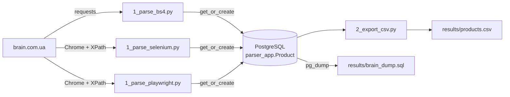

<div align="center">

# 🧠 brain.com.ua Product Parsers

**Three independent parsers for one product card — Requests + BS4, Selenium and Playwright —
backed by Django + PostgreSQL with CSV export.**


[Quick start](#-quick-start) •
[Parsers](#-parsers) •
[Collected data](#-collected-data) •
[XPath map](#-xpath-map) •
[Project rules](#-project-rules-checklist) •
[Django setup guide](docs/DJANGO_SETUP.md)

</div>

---

## 📌 Overview

| # | Parser | Entry point | How it gets to the product |
|---|---|---|---|
| 1 | **Requests + BS4** | [`modules/1_parse_bs4.py`](modules/1_parse_bs4.py) | Direct GET of the iPhone 16 Pro Max product URL |
| 2 | **Selenium** | [`modules/1_parse_selenium.py`](modules/1_parse_selenium.py) | Home page → search *"Apple iPhone 15 128GB Black"* → first result |
| 3 | **Playwright** | [`modules/1_parse_playwright.py`](modules/1_parse_playwright.py) | Same flow as Selenium, sync API |
| — | **CSV export** | [`modules/2_export_csv.py`](modules/2_export_csv.py) | DB → `results/products.csv` |

Every parser collects the same 12 fields, prints them with `pprint` and saves them
into one `Product` model through `get_or_create`.



---

## 🗂 Project structure

```
brain-parsers/
├── braincomua_project/            # Django project
│   ├── manage.py
│   ├── braincomua_project/        # settings (Postgres via env vars)
│   └── parser_app/                # Product model + admin
├── modules/                       # all parser scripts, numbered by run order
│   ├── load_django.py             # boots Django from outside the project folder
│   ├── 0_check_db_write.py        # sanity check: write to the model
│   ├── 0_check_db_read.py         # sanity check: read + print
│   ├── 1_parse_bs4.py
│   ├── 1_parse_selenium.py
│   ├── 1_parse_playwright.py
│   └── 2_export_csv.py
├── results/
│   ├── products.csv               # CSV export
│   └── brain_dump.sql             # PostgreSQL dump
├── scripts/
│   └── run_all.sh                 # whole pipeline in one command
├── docs/
│   ├── DJANGO_SETUP.md            # step-by-step Django + Postgres setup
│   └── DJANGO_SETUP.docx          # same guide as a Word document
├── docker-compose.yml             # PostgreSQL 16
└── requirements.txt
```

---

## 🚀 Quick start

```bash
# 1. Environment
python3 -m venv .venv && source .venv/bin/activate
pip install -r requirements.txt

# 2. Database
docker compose up -d
cd braincomua_project && python manage.py migrate && cd ..

# 3. Check that load_django works
cd modules
python 0_check_db_write.py
python 0_check_db_read.py

# 4. Parse
python 1_parse_bs4.py
python 1_parse_selenium.py
python 1_parse_playwright.py

# 5. Export
python 2_export_csv.py
docker exec brain-parsers-db pg_dump -U brain --no-owner brain > ../results/brain_dump.sql
```

Or everything at once — DB, migrations, all three parsers, CSV export and DB dump:

```bash
./scripts/run_all.sh
```

**Recommended for brain.com.ua — attach to a normally started Chrome** (see the note below):

```bash
# macOS (Linux: google-chrome --user-data-dir=... --remote-debugging-port=9222 ...)
open -na "Google Chrome" --args --user-data-dir="$HOME/.cache/brain-parsers/chrome_attach" \
    --remote-debugging-port=9222 --no-first-run "https://brain.com.ua/ukr/"

CHROME_DEBUGGER_ADDRESS=127.0.0.1:9222 ./scripts/run_all.sh
```

<details>
<summary><b>Environment variables</b> (all optional, defaults match docker-compose)</summary>

| Variable | Default |
|---|---|
| `POSTGRES_DB` | `brain` |
| `POSTGRES_USER` | `brain` |
| `POSTGRES_PASSWORD` | `brain` |
| `POSTGRES_HOST` | `localhost` |
| `POSTGRES_PORT` | `5432` |
| `CHROME_DEBUGGER_ADDRESS` | not set. If set (e.g. `127.0.0.1:9222`), both browser parsers attach to that running Chrome instead of launching their own |
| `CHROME_PROFILE_DIR` | `~/.cache/brain-parsers/chrome_profile` (shared by Selenium and Playwright) |
| `SECURITY_CHECK_TIMEOUT` | `180` — seconds a browser parser waits for a manual security check |

</details>

> **Browser parsers & the security check.** brain.com.ua sits behind Cloudflare. A Chrome launched *by*
> chromedriver / Playwright gets a *"confirm you are human"* page, and after many runs from one IP
> Cloudflare stops accepting even a manual click in that window. So both parsers support two modes:
>
> - **Attach mode** (`CHROME_DEBUGGER_ADDRESS`) — Chrome is started normally with `--remote-debugging-port`
>   in a separate profile; Selenium attaches via `debuggerAddress`, Playwright via `connect_over_cdp`.
>   If a check shows up, it is passed by hand in that window. This is how the committed results were collected.
> - **Launch mode** (default) — the parser starts its own Chrome with a persistent profile shared by both
>   parsers. If the check appears, the script pauses (`SECURITY_CHECK_TIMEOUT`, 3 min by default) for a manual pass.
>
> In both modes the scripts only *wait* for a human — nothing tries to solve or bypass the check.
> The profile lives outside `Desktop`/`Documents` because macOS blocks Chrome from those folders
> without a permission prompt.

---

## 🔍 Parsers

### 1 · Requests + BS4

- One `requests.get` with browser-like headers
- The characteristics container (`div.br-pr-chr`) is found **once** and reused for every lookup
- Values are taken **by title, not by position**: find `<span>Колір</span>` → take the next `<span>`

### 2 · Selenium

- Search input and button, first result, product fields — **XPath only**
- Typing a query opens the site's quick-search popup whose own **«Знайти»** button covers the header one —
  the parser clicks whichever button is actually visible
- `WebDriverWait` + `expected_conditions` on every transition (home → results → product) plus short `sleep`s
- Clicks *"Всі характеристики"* before reading specs; values are read via `textContent`, so collapsed rows are not lost
- Every lookup has its own `try/except NoSuchElementException` → `None`

### 3 · Playwright

- Sync API (single page, no concurrency needed → Django ORM works without `sync_to_async`)
- One browser (persistent context) for the whole run, `channel="chrome"`
- Locators are XPath (`xpath=...`), missing elements are checked with `.count()` → `None`
- Explicit waits: `wait_for_url`, `locator.wait_for`, `wait_for_load_state`
- Same popup-aware search button logic as the Selenium parser

---

## 📦 Collected data

| Field | Model type | Example |
|---|---|---|
| `name` | `CharField` | Мобільний телефон Apple iPhone 16 Pro Max 256GB Black Titanium (MYWV3) |
| `product_code` | `CharField` | U0961530 |
| `manufacturer` | `CharField` | Apple |
| `color` | `CharField` | чорний |
| `memory` | `CharField` | 256 Gb |
| `price` | `IntegerField` | 65799 |
| `sale_price` | `IntegerField` | `None` (26999 for a discounted item) |
| `reviews_count` | `IntegerField` | 1 |
| `screen_diagonal` | `CharField` | 6.9" |
| `screen_resolution` | `CharField` | 1320 х 2868 |
| `photos` | `ArrayField(URLField)` | 9 image URLs |
| `specifications` | `JSONField` | 43 key → value pairs |
| `parser` / `link` / `created_at` | service fields | bs4 · product URL · timestamp |

**Live run results** ([`results/products.csv`](results/products.csv)) — Selenium and Playwright rows are identical field by field:

| Parser | Product | Code | Price, ₴ | Sale | Reviews | Screen | Photos | Specs |
|---|---|---|---|---|---|---|---|---|
| bs4 | Apple iPhone 16 Pro Max 256GB Black Titanium (MYWV3) | U0961530 | 65 799 | — | 1 | 6.9" · 1320 х 2868 | 9 | 43 |
| selenium | Apple iPhone 15 128GB Black (MTP03) | U0854689 | 35 499 | — | 1 | 6.1" · 1179 х 2556 | 3 | 40 |
| playwright | Apple iPhone 15 128GB Black (MTP03) | U0854689 | 35 499 | — | 1 | 6.1" · 1179 х 2556 | 3 | 40 |

**Price logic.** The price block has `br-pr-np` (current price) and, only for discounted items,
`br-pr-op` (old price). If `br-pr-op` exists → `price` = old, `sale_price` = current;
otherwise `price` = current, `sale_price` = `None`.

<details>
<summary><b>Sample output</b> — <code>python 1_parse_bs4.py</code></summary>

```python
{'name': 'Мобільний телефон Apple iPhone 16 Pro Max 256GB Black Titanium (MYWV3)',
 'product_code': 'U0961530',
 'manufacturer': 'Apple',
 'color': 'чорний',
 'memory': '256 Gb',
 'price': 65799,
 'sale_price': None,
 'reviews_count': 1,
 'screen_diagonal': '6.9"',
 'screen_resolution': '1320 х 2868',
 'photos': ['https://brain.com.ua/static/images/prod_img/3/0/U0961530_1738426633.jpg',
            'https://brain.com.ua/static/images/prod_img/3/0/U0961530_2_1738426634.jpg',
            ...],
 'specifications': {'Форм-фактор': 'моноблок',
                    'Кількість SIM-карт': '1 SIM + e-sim',
                    'Тип дисплея': 'OLED (Super Retina XDR)',
                    'Процесор': 'Apple A18 Pro',
                    'Основна камера': '48 + 48 + 12 Mpx',
                    'Матеріал корпуса': 'титан, алюміній',
                    'Вага': '227 г',
                    ...},
 'parser': 'bs4',
 'link': 'https://brain.com.ua/ukr/Mobilniy_telefon_Apple_iPhone_16_Pro_Max_256GB_Black_Titanium-p1145443.html'}
Saved to DB: id=2, created=True
```

</details>

---

## 🧭 XPath map

Short, class-based XPaths — no copied absolute paths.

| Target | XPath |
|---|---|
| Search input | `//input[contains(@class, 'search-button-first-form')]/preceding-sibling::input[@type='search']` |
| Search button (header) | `//input[contains(@class, 'search-button-first-form')]` |
| Search button (quick-search popup) | `//input[@class='qsr-submit']` |
| First search result | `(//div[contains(@class, 'br-pp-img-grid')]/a)[1]` |
| Product name | `//h1[contains(@class, 'main-title')]` |
| Product code | `//span[@class='br-pr-code-val']` |
| Characteristics block | `//div[@class='br-pr-chr']` |
| Value by title | `.//span[text()="Колір"]/following-sibling::span` |
| Current / old price | `./div[@class='br-pr-np']//span` · `./div[@class='br-pr-op']//span` |
| Reviews count | `//a[contains(@class, 'reviews-count')]/span` |
| Photos | `//img[contains(@class, 'br-main-img')]` |
| Characteristic rows | `.//div[@class='br-pr-chr-item']/div/div[span]` |
| "All characteristics" | `//button[span[text()='Всі характеристики']]` |

---

## ✅ Project rules checklist

- [x] Values found **by title**, not by index — works when fields move on another product
- [x] **Separate `try/except` per field** with a **specific** exception (`AttributeError`, `NoSuchElementException`)
- [x] Missing value → **`None`** (no "Not found" / "N/A" strings)
- [x] Short class-based XPaths, no copied absolute paths
- [x] All data collected into **one dict** → `pprint`
- [x] **English** only in variables, comments and prints
- [x] `get_or_create(**product)` with **all values, no `defaults`, no processing inside**
- [x] Shared container searched **once** and reused
- [x] **Waits** after every navigation / click in Selenium & Playwright
- [x] Model: every field `null=True`, important fields first, lists in `ArrayField` / `JSONField`, service fields last
- [x] Scripts in `modules/`, numbered by run order, each starts with a docstring
- [x] Results (CSV + DB dump) in `results/`

---

## 🛠 Django setup guide

Step-by-step, command-by-command guide for spinning up an empty Django + Postgres
project with `parser_app`, `modules/` and `load_django.py` in 5–10 minutes:
**[docs/DJANGO_SETUP.md](docs/DJANGO_SETUP.md)** (Word version: [docs/DJANGO_SETUP.docx](docs/DJANGO_SETUP.docx))
